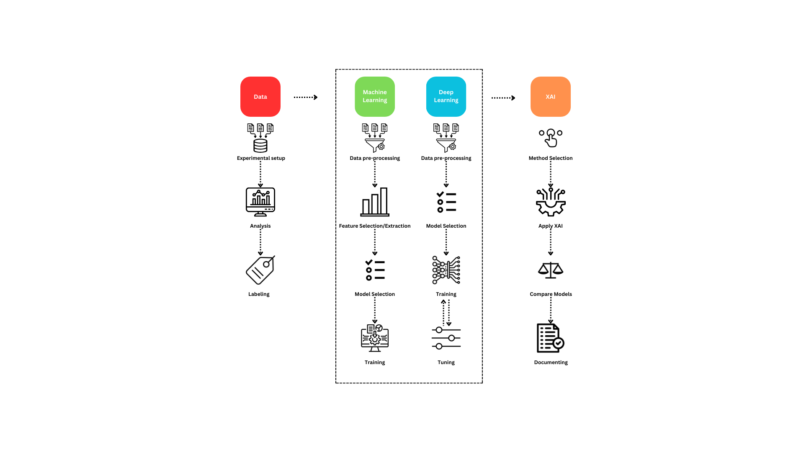
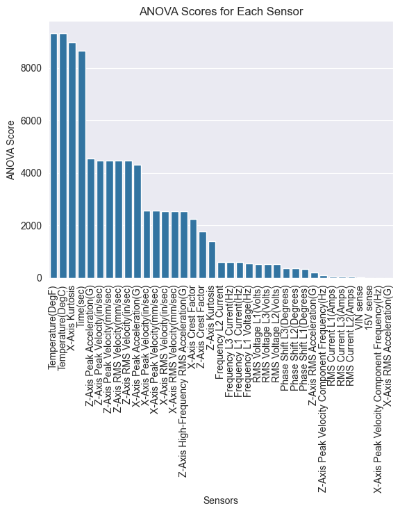
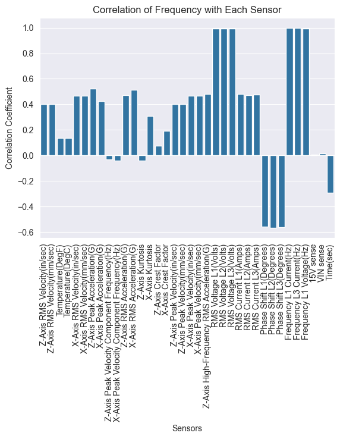

<div align="center">

<h1>Explainable ML for Predictive Maintenance</h1>

<p><b>Detecting machine misalignment from vibration sensor data — a BSc thesis research archive</b></p>

<p>
  
  
  
  
  <a href="LICENSE"></a>
</p>

</div>

This repository archives my **bachelor thesis research** at the University of Twente: classifying the health state of rotating machinery — **normal vs. (light / heavy) misalignment** — from vibration sensor signals recorded across a range of operating frequencies, and comparing classical ML against deep learning with an emphasis on **explainability (XAI)**. It collects the exploratory notebooks, feature-analysis figures, the research proposal, and presentation material behind the project.

<p align="center">
  
</p>

<p align="center"><sub><b>Figure 1.</b> The study pipeline — from raw sensor data through ML/DL models to explainability.</sub></p>

## What's here

- **Signals → labels.** Vibration recordings are organised by session and labelled by condition and excitation frequency (e.g. `Normal_25Hz`, `misalign_17Hz`, `heavy_misalign_30Hz`), then turned into model-ready datasets.
- **Feature analysis.** Time-domain and frequency-domain views, with ANOVA and correlation studies to find the features that separate the fault classes.
- **Models.** A Gradient Boosting classifier and a feed-forward neural network, compared on the same task.
- **Explainability.** A survey of XAI methods (Grad-CAM, SHAP, TS-MULE and related time-series approaches — see `research/`) applied to interpret the models' decisions.

## Feature-analysis figures

<p align="center">
  
  &nbsp;
  
</p>

<p align="center"><sub>Feature significance (ANOVA) and frequency–sensor correlation used to select discriminative features.</sub></p>

## Repository layout

```
.
├── code/
│   ├── data.ipynb / dataset_creation.ipynb   # load sensor sessions → labelled datasets
│   ├── playground.ipynb                       # exploratory analysis
│   ├── analysis/                              # per-session graph & histogram views, processed data
│   └── models/
│       ├── GradientBoostingClassifier.ipynb   # classical ML baseline
│       └── FeedForward.ipynb                   # neural-network model
├── research/                                   # background papers (XAI, predictive maintenance)
├── slides/ · presentations/                    # proposal & progress talks
├── research_proposal.pdf / .docx               # the research proposal
└── *.png                                       # pipeline + feature-analysis figures
```

## Notes

This is a **research archive**, not a packaged library — the notebooks document the exploration as it happened. Raw proprietary sensor recordings are not redistributed here; the notebooks show the processing and modelling steps applied to them.

## License

Code and notebooks are released under the [MIT License](LICENSE). Third-party papers under `research/` remain under their original copyright.
